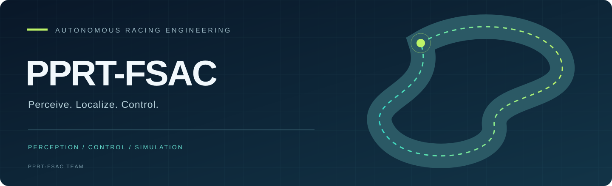

  

<strong>感知赛道 · 理解状态 · 控制车辆</strong>

面向 FSAC 无人赛车的感知、定位、控制与仿真研发。

  <a href="https://github.com/orgs/PPRT-FSAC-team/repositories">项目仓库</a> ·
  <a href="https://github.com/PPRT-FSAC-team/.github/blob/main/CONTRIBUTING.md">协作指南</a>

---

### Engineering domains / 研发方向

<table>
<tr>
<td width="33%"><strong>01 / PERCEPTION</strong>  视觉与激光感知 目标检测、跟踪与点云处理。</td>
<td width="33%"><strong>02 / LOCALIZATION</strong>  定位与建图 车辆位姿、坐标转换与激光建图。</td>
<td width="33%"><strong>03 / CONTROL</strong>  轨迹跟踪与线控 路径跟踪算法、控制接口与车辆通信。</td>
</tr>
<tr>
<td><strong>04 / SIMULATION</strong>  仿真与场景 赛道生成、锥桶模型与 Gazebo 场景。</td>
<td><strong>05 / INTERFACES</strong>  系统接口 ROS 消息、服务与模块间数据约定。</td>
<td><strong>06 / OPERATIONS</strong>  任务与调试 任务界面、启动流程与开发文档。</td>
</tr>
</table>

### From modules to a system / 从模块到系统

我们按功能模块管理代码，将算法、接口定义、配置与使用说明放在对应仓库中。项目状态以各仓库的说明和验证记录为准；源码按仓库访问权限提供。

**ROS · C++ · Python · Computer Vision · LiDAR · Vehicle Control · Gazebo**

### Working together / 协作约定

以下流程用于后续开发与文档维护：

1. **明确任务** — 说明问题、影响模块与验收条件。
2. **独立分支** — 每个分支解决一个明确问题，提交写清实际改动。
3. **提交评审** — PR 说明变更、验证方法与尚未完成的工作。
4. **记录结果** — 由实际参与者记录评审意见、实验环境与验证结果。

接口变更应同步通知受影响模块并更新文档。开源依赖保留来源与许可证说明，具体贡献以对应提交和贡献记录为准。

---

<strong>PPRT-FSAC</strong> Autonomous racing. Built through engineering.

