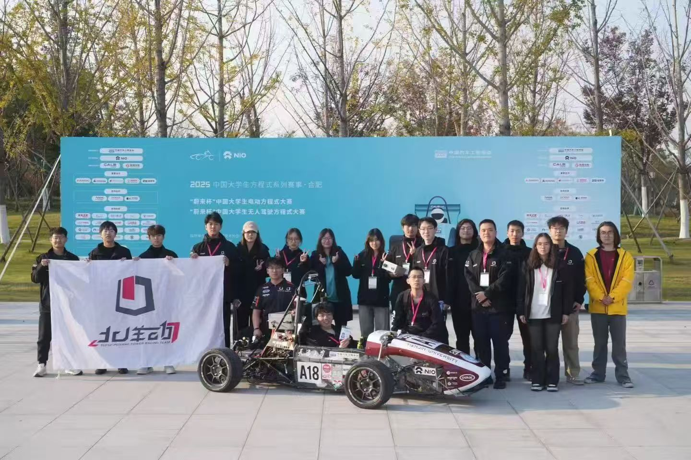
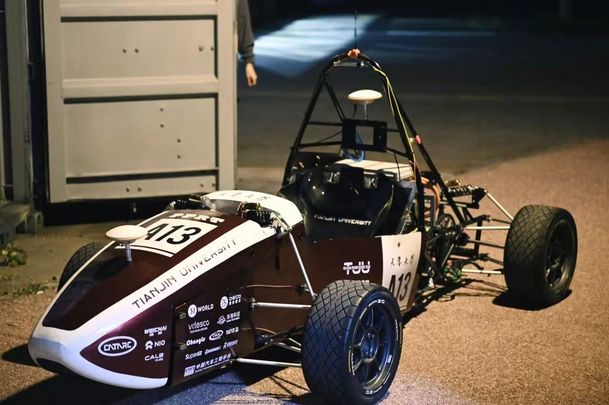

<h1 align="center">天津大学北洋动力无人驾驶车队</h1>

Peiyang Power Racing Team · PPRT-FSAC

  <a href="#关于车队">关于车队</a> &nbsp; / &nbsp;
  <a href="#赛车与技术">赛车与技术</a> &nbsp; / &nbsp;
  <a href="#车队动态">车队动态</a> &nbsp; / &nbsp;
  <a href="https://github.com/orgs/PPRT-FSAC-team/repositories">代码仓库</a>

2025 中国大学生方程式系列赛事 · 车队合影

## 关于车队

北洋动力是天津大学的大学生方程式赛车队，成立于 2009 年，也是中国大学生方程式系列赛事的创始车队之一。我们设计、制造“浩跃”系列赛车，参加大学生方程式赛事，在造车过程中学习车辆设计、制造与调试。[1]

无人驾驶车队成立于 2022 年，依托天津大学机械工程学院和先进内燃动力全国重点实验室，开展无人驾驶方程式赛车研发，参加中国大学生无人驾驶方程式大赛（FSAC）。[2] 这里是车队的软件项目主页，收录感知、定位、控制及车辆接口等模块的代码与开发文档。

## 赛车与技术

<table>
<tr>
<td width="52%" valign="top">

A13 号无人驾驶方程式赛车
</td>
<td width="48%" valign="top">
<h3>浩跃 EV3 · 2024 赛季</h3>

浩跃 EV3 是天津大学第二辆无人驾驶电动方程式赛车，获得 2024 年中国大学生无人驾驶方程式大赛全国三等奖。

该赛季的无人驾驶系统采用视觉与点云融合感知，并配备自主研发的人机交互系统和电子围栏安全冗余设计。

<a href="https://me.tju.edu.cn/info/1890/33201.htm">阅读学院赛事报道 ↗</a>

</td>
</tr>
</table>

无人驾驶系统的工作涵盖环境感知、定位建图、轨迹跟踪及整车集成。2024 赛季公开的技术方案包括激光雷达与摄像头联合感知、激光 SLAM 定位建图，以及模型预测控制（MPC）轨迹跟踪。[2]

本组织按功能维护软件项目，主要包括：

| 方向 | 工作内容 |
| :--- | :--- |
| 感知与定位 | 视觉检测、点云处理、车辆位姿与坐标转换 |
| 车辆控制 | 轨迹跟踪、线控接口与车辆通信 |
| 系统与工具 | ROS 消息定义、任务交互界面、仿真场景与调试工具 |

## 车队动态

| 日期 | 内容 |
| :--- | :--- |
| 2026.05.27 | [北洋动力车队赴长城汽车技术中心交流，围绕赛车设计、空气动力学与车队建设开展讨论。](https://me.tju.edu.cn/info/1880/52171.htm) |
| 2024.10 | [浩跃 EV3 参加合肥无人驾驶方程式赛事，获得全国三等奖。](https://me.tju.edu.cn/info/1890/33201.htm) |

---

[浏览代码仓库](https://github.com/orgs/PPRT-FSAC-team/repositories) · [开发与贡献指南](https://github.com/PPRT-FSAC-team/.github/blob/main/CONTRIBUTING.md) · [天津大学机械工程学院](https://me.tju.edu.cn/)

车队介绍资料

[1] 中国汽车工程学会：[2024 FSCC 竞赛手册 · 天津大学北洋动力车队](https://img.sae-china.org/web/2024/10/2024FSCC%E7%AB%9E%E8%B5%9B%E6%89%8B%E5%86%8CHandbook.pdf)  
[2] 中国汽车工程学会：[2024 FSEC / FSAC 竞赛手册 · A13 天津大学北洋动力无人驾驶车队](https://img.sae-china.org/web/2024/10/2024FSEC%E7%AB%9E%E8%B5%9B%E6%89%8B%E5%86%8CHandbook.pdf)

